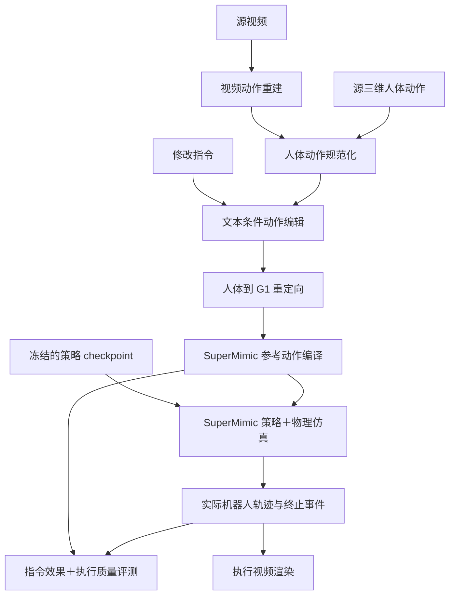

# VisualMimic 第一阶段接口 v2：以 SuperMimic 为执行核心

状态：v2 机器人契约、真实编辑／重定向／编译／执行适配器已开始落地，详见 README。contracts.py / runner.py 保留人体层基础接口，experiment_runner.py 编排机器人链路。完整两路实验仍未验收；接口测试通过不能证明完整实验完成。

## 1. 任务边界

输入：源动作视频或源三维人体动作，以及文本修改指令。
输出：SuperMimic 在物理仿真中的实际机器人轨迹、执行视频、指令效果及执行质量报告。

SuperMimic 是核心执行系统；人体重建和编辑模块负责提供它需要的参考动作。第一阶段包含两条对照完整执行，不包含第二阶段联合视觉模型。首轮建议使用同一个冻结的 SuperMimic 策略 checkpoint，控制视频输入的影响；这是实验控制选择，不代表项目不研究 SuperMimic 训练。



视频输入和三维输入在同一人体表示处汇合，此后共享编辑、重定向、编译和执行配置。TMED、GVHMR 都是可替换后端，不成为公共契约的模型名称。

## 2. 公共数据类型

以下为设计级签名，数组实际存为带 schema 和内容哈希的文件。复用 v1 的 ArtifactRef 和 SampleKey。

### 2.1 输入与人体动作

```python
Source3DRequest(key, instruction, source_human_motion: ArtifactRef)
VideoRequest(key, instruction, video: VideoInput)

HumanMotion(
    representation_id, body_model_id, joint_names,
    timestamps_s, coordinate_spec, field_schema, fields, valid_mask,
)
```

`field_schema` 明确字段维度、dtype、单位、旋转和参考系；参数化人体模型与机器人表示不能混用。源人体和重建人体都先转换到编辑器声明的规范。目标动作、目标长度、目标 mask 不出现在推理请求里。

### 2.2 机器人与重定向产物

```python
RobotSpec(
    robot_id, model_asset: ArtifactRef, joint_names, body_names,
    root_body, coordinate_spec, joint_limits: ArtifactRef,
)

RobotMotion(
    robot_spec_id, timestamps_s,
    root_pos_w,       # [T,3], metres
    root_quat_wxyz,   # [T,4], unit quaternion, world orientation
    joint_pos,       # [T,J], radians, RobotSpec joint order
    valid_mask,
)

RetargetResult(
    motion: ArtifactRef, mapping_id, diagnostics: ArtifactRef,
    status,          # accepted / rejected
    reasons,
)
```

重定向包含人体比例与机器人运动学映射，不等同于转换数组维度。关节越界、不可解帧和落地修正必须记录；不静默裁剪或声称参考动作已经动力学可执行。可执行性由后续物理仿真验证。

### 2.3 SuperMimic 参考输入

```python
TrackingReference(
    reference_id, robot_spec_id, motion_npz: ArtifactRef,
    num_frames, fps, duration_s, compiler_identity,
    provenance: ArtifactRef,
)
```

本地 SuperMimic-Reproduced 的 NPZ 读取契约为：

| 字段 | 当前 G1 后端形状／约定 |
|---|---|
| fps | 采样率标量，必须与执行后端时基核对 |
| joint_pos / joint_vel | [T,29]，rad / rad·s⁻¹ |
| body_pos_w | [T,30,3]，世界坐标，m |
| body_quat_w | [T,30,4]，wxyz |
| body_lin_vel_w / body_ang_vel_w | [T,30,3]，世界坐标速度 |
| joint_names / body_names | 与机器人模型严格对应 |

这些数字属于当前 G1 实现，不是通用接口的硬编码。编译器根据 RobotSpec、执行时基和 FK 后端校验后生成 NPZ。必须记录重采样规则、速度计算规则和实际时长；禁止从未知人体字段直接凑出 NPZ。

### 2.4 策略、执行协议与结果

```python
PolicyBundle(
    checkpoint: ArtifactRef, implementation_commit, robot_spec_id,
    observation_spec_id, action_spec_id, environment_config: ArtifactRef,
    training_manifest: ArtifactRef | None,
)

ExecutionProtocol(
    protocol_id, seed, sim_config: ArtifactRef,
    initialization,          # reference_start / explicit_robot_state
    explicit_initial_state: ArtifactRef | None,
    phase_start, horizon_policy,
    noise_config, domain_randomization_config,
    termination_config, recording_config,
)

RobotRollout(
    rollout_id, reference_id, policy_id, protocol_id,
    states: ArtifactRef,     # t0 状态＋每个物理步之后的状态，包括终止状态
    actions: ArtifactRef,    # 每个转移的策略输出及实际执行控制量，说明单位
    reference_samples: ArtifactRef,  # 对应各状态的参考时间／帧与参考值
    events: ArtifactRef,     # 完成、任务终止、超时等，分开记录
    planned_steps, executed_steps,
    outcome,                # completed / terminated / truncated
)
```

动作 K 步对应状态 K+1 帧。实际状态包含 root pose/twist、joint pos/vel、所需 body states；接触和力矩若后端可取则记录，否则标记 unavailable，不能填零当观测。

执行错误用 StageError 单独返回，不伪造 rollout。物理终止是有效的执行结果，不能等同于后端程序错误。若环境自动 reset，必须捕获 reset 前终止状态，不能拼接到下一 episode。

## 3. 模块接口

### 3.1 数据准备：DatasetProvider / InputRenderer

```python
prepare(config) -> DatasetManifests
render_source(human_motion, render_config) -> VideoArtifact
get_source_requests(split) -> Iterator[Source3DRequest]
get_video_requests(split) -> Iterator[VideoRequest]
```

准备侧维护 MotionFix 原划分、人体源动作、编辑标签、视频生成配置和目标动作；执行侧只获得当前输入。InputRenderer 生成供重建器使用的人体源视频，与机器人执行视频渲染分开。

### 3.2 重建与人体表示：HumanReconstructor / HumanNormalizer

```python
reconstruct(video: VideoInput) -> HumanReconstruction
normalize(motion: HumanMotion, target_spec, policy) -> NormalizedHumanMotion
```

重建不读取修改文本或真值。规范化处理人体模型兼容性、坐标、朝向和时间采样，记录可逆变换与不可逆假设。视频分支不能从真实源动作补全尺度或关节。

### 3.3 参考动作编辑：HumanMotionEditor

```python
edit(source: HumanMotion, instruction: str,
     generation: GenerationOptions) -> HumanEditResult
```

结果包含编辑人体动作、生成设置和记录，不包含机器人执行成功结论。首轮可封装 TMED。两条路径固定同一编辑 checkpoint；输出长度遵循统一、不读取目标长度的策略。官方已知目标长度复现另列协议。

### 3.4 人体到机器人：RobotRetargeter

```python
retarget(motion: HumanMotion, robot: RobotSpec,
         config: RetargetConfig) -> RetargetResult
```

输入只含待执行的人体动作和固定映射配置，不含目标真值或为当前样本人工调整的答案。配置声明人体尺寸处理、根运动映射、关节对应、接触／地面对齐及失败策略。重定向 diagnostics 区分姿态匹配误差、越界和时序异常。

### 3.5 参考动作编译：ReferenceCompiler

```python
compile(motion: RobotMotion, robot: RobotSpec,
        tracking_spec: TrackingSpec) -> TrackingReference
```

复用本地 motion_convert.py 的重采样、四元数处理、MuJoCo FK 和速度构造。该文件处理的是已经重定向的 G1 动作，不能代替 RobotRetargeter。

### 3.6 核心执行：SuperMimicExecutor

```python
load(policy: PolicyBundle, runtime: RuntimeConfig) -> ExecutorSession
execute(reference: TrackingReference,
        protocol: ExecutionProtocol) -> ExecutionResult
close() -> None

ExecutionResult(status, rollout: RobotRollout | None, error: StageError | None)
```

load 校验机器人模型、观测／动作配置和 checkpoint 一致性；不能在不同 anchor_obs 或 future_frames 设置下悄悄加载运行。参考轨迹由 SuperMimic 原生 motion library 构造 goal，机器人本体状态由环境构造 policy observation。不要在上游复制这些内部逻辑。

第一版是物理仿真执行，不声明真机部署。运行中不更新策略；世界模型不作为仿真器替代品提供最终评测轨迹。

### 3.7 执行视频：RolloutRenderer

```python
render_rollout(rollout: RobotRollout, config: RobotRenderConfig) -> VideoArtifact
```

依据已记录实际轨迹渲染，不重新执行策略获取另一个 episode。参考 ghost 可用于诊断，但用于指令判分的视频只呈现实际机器人。相机、时间剪辑和回放速度需记录，未完成部分不能用循环／重置补齐。

### 3.8 评测：TrackingEvaluator / InstructionEvaluator / HumanEditEvaluator

```python
evaluate_tracking(reference, rollout, protocol) -> TrackingReport
evaluate_instruction(instruction, baseline_rollout, edited_rollout,
                     task_definition, protocol) -> InstructionReport
evaluate_human_edit(prediction, held_out_target, protocol) -> HumanEditReport
```

- TrackingReport：完成率／失败时间、参考跟踪误差、原生奖励及各项分量。奖励分数不能充当指令完成度。原生归一化回报与全计划时长覆盖率分开，防止提前终止使存活段均值看起来更高。
- InstructionReport：在真实机器人轨迹上检查修改方向、幅度与应保持的属性。第一版以有明确物理定义的指令为评测子集；任意 MotionFix 文本如无可靠评测器，返回未评估，而非自动套用抬脚高度等指标。
- HumanEditReport：人体编辑层的中间诊断，不能代替机器人任务结果。

相对指令默认需要同一路径的未编辑执行作 baseline：源人体动作直接经过同一 retarget/compile/execute。A、B 各自保存 unedited 与 edited 两个 rollout，不使用 B 路不可见的真实源动作作为 B 的推理输入。跨 A/B 的比较仅在评测端进行。

reference_start 初始化下，各动作可能有不同起始姿态；报告应明确“相同初始化规则”，不能声称物理初态完全相同。若采用共同初态，必须显式提供并记录过渡策略，不默默插入过渡动作。

### 3.9 总编排：VisualMimicRunner

```python
run_source(request: Source3DRequest, experiment: ExperimentSpec) -> TrialResult
run_video(request: VideoRequest, experiment: ExperimentSpec) -> TrialResult

TrialResult(
    key, branch, trial_id, stage_status,
    source_human, edited_human, retarget_results, tracking_references,
    baseline_execution, edited_execution,
    reports, provenance,
)
```

一个 Trial 的完成至少要求规定执行与报告产物存在；“编辑完成”只是中间状态。分别统计 reconstruction_error、editing_error、retarget_rejected、compile_error、execution_error、terminated、completed、evaluation_error；不可用样本留在总分母里。

ExperimentSpec 固定编辑器、重定向器、编译器、SuperMimic policy bundle、仿真协议、种子、指令及样本集合。B 路仅多出重建过程。所有中间输出可追踪到同一个 trial；策略哈希变化必须生成新的实验条件。

## 4. SuperMimic 训练接口：与冻结执行分开

```python
train_supermimic(
    references: TrainingReferenceManifest,
    training_config: ArtifactRef,
    resume: TrainingCheckpointBundle | None,
) -> TrainingRunHandle

inspect_training(run: TrainingRunHandle) -> TrainingStatus
export_policy(checkpoint: TrainingCheckpointBundle) -> PolicyBundle
```

TrainingReferenceManifest 仅含允许训练的机器人参考动作及原始样本划分。训练恢复 bundle 包含 policy、world model、critic、优化器、随机状态和训练计数，不能拿仅有策略的 PolicyBundle 假装完整恢复训练。

复用现有 SuperMimic training/world_model/imagination 实现。保持“真实仿真收集 → 世界模型学习 → 想象中策略更新”的内部训练边界。首轮不因 A/B 分支不同而各训练一个策略；如研究适应或再训练，新增实验条件并控制数据、预算和评测集合。

训练状态、checkpoint 导出、跟踪能力验证、指令效果提升是四种独立证据。

## 5. 现有代码复用与迁移

| 当前代码 | v2 处理 |
|---|---|
| contracts.py / storage.py | 复用样本身份和产物基础；人体／机器人／rollout 类型分开扩展 |
| reconstruction.py / editing.py / rendering.py | 收窄为人体输入与编辑模块 |
| adaptation.py | 定位为 HumanNormalizer；不兼任人体到机器人重定向 |
| runner.py | 原类保留为人体编辑子流程；新增包含 SuperMimic 的顶层 Runner |
| evaluation.py / diagnostics.py | 保留人体诊断；新增 tracking 与 instruction 评测 |
| SuperMimic motion_convert.py | 复用参考编译，不宣称具有人体重定向能力 |
| SuperMimic eval/benchmark.py | 复用策略加载、环境与原生指标；增加完整 rollout 和终止前记录 |
| SuperMimic deployment/render_evaluation.py | 参考轨迹采集／渲染做法；去掉固定路径、样本和时间剪辑 |

拟新增模块：robot_contracts.py、retargeting.py、reference_compiler.py、supermimic_executor.py、rollout_rendering.py、tracking_evaluation.py、instruction_evaluation.py、experiment_runner.py、supermimic_training.py。

实现顺序以执行核心为先：

1. 已有 G1 参考动作 → SuperMimicExecutor → 完整 rollout → 跟踪评测，先验证执行接口。
2. 人体源动作 → 重定向 → 编译 → 同一执行接口，验证人体与机器人边界。
3. 加入文本编辑，形成 A 路 unedited/edited 对照和指令效果评测。
4. 加入视频重建，形成 B 路并进行匹配比较。

本地后端是独立 SuperMimic-Reproduced 实现；报告固定代码和资产版本，不把复现项目的运行或指标自动归为作者官方实现结果。
